# Spotify × Grammys

### ¿Ganar un Grammy hace que un artista sea más escuchado hoy?

Este proyecto junta dos fuentes de información que nunca se habían cruzado —las canciones de **Spotify** y la historia de los premios **Grammy**— para responder esa pregunta con datos.


> **Taller 2 · ETL con Apache Airflow** — Curso de E.T.L., Corte 2.

---

## El proyecto en una mirada

| | |
|---|---|
| **Canciones de Spotify revisadas** | 114.000 |
| **Premios Grammy revisados** | 4.810 |
| **Artistas en la lista final** | 30.907 |
| **Artistas que aparecen en las dos fuentes** | 533 |
| **Procesos automáticos funcionando** | 3 de 3 |
| **Gráficas de análisis** | 12 |

**La respuesta corta:** no. En los datos analizados, los artistas con Grammy **no son claramente más escuchados** en Spotify que los demás, y la época en la que ganaron tampoco muestra una tendencia clara. El Grammy y la popularidad en Spotify parecen medir cosas distintas.

Este resultado describe una **asociación, no una causa**, y se calcula sobre los artistas que aparecen en las dos fuentes (ver la sección 5).

### Tecnologías usadas

| Herramienta | Para qué se usa | Versión |
|---|---|---|
| Apache Airflow | Orquestar las tareas del pipeline | 3.3.1 (imagen de Docker) |
| Docker y Docker Compose | Ejecutar Airflow sin instalarlo a mano | n. d. |
| PostgreSQL | Guardar las fuentes y el resultado | 18 |
| Python | Código del pipeline | 3.13 (dentro del contenedor) |
| Pandera | Validación de calidad de datos | 0.34.1 |
| pandas y SQLAlchemy | Transformación y lectura de datos | n. d. |
| Jupyter, matplotlib, seaborn y SciPy | Análisis y gráficas | n. d. |

---

## Índice

1. [Cómo empezó](#1--cómo-empezó)
2. [La idea: qué se planeó](#2--la-idea-qué-se-planeó)
3. [Cómo se construyó, paso a paso](#3--cómo-se-construyó-paso-a-paso)
4. [Qué descubrimos](#4--qué-descubrimos)
5. [Lo que hay que tener en cuenta](#5--lo-que-hay-que-tener-en-cuenta)
6. [Cómo correr el proyecto](#6--cómo-correr-el-proyecto)
7. [Qué hay en cada carpeta](#7--qué-hay-en-cada-carpeta)

---

## 1 · Cómo empezó

El punto de partida fueron **dos archivos que no se conocían entre sí**:

| | Spotify | Grammys |
|---|---|---|
| **Archivo** | `dataset_spotify.csv` | `the_grammy_awards.csv` |
| **Qué contiene** | Canciones, con datos como qué tan popular es, qué tan bailable o enérgica es, cuánto dura y su género | Cada premio entregado: año, categoría, obra y artista ganador |
| **Tamaño** | 114.000 canciones | 4.810 premios |
| **Dónde vive** | Archivo en la carpeta `data/` | Cargado en una base de datos PostgreSQL |

El problema: Spotify habla de **canciones** y los Grammys hablan de **premios**. Para compararlos hacía falta llevar ambos a un mismo idioma: **el artista**.

Las instrucciones del taller están en `docs/Lo_que_hay_que_hacer/`.

---

## 2 · La idea: qué se planeó

La lógica es la de una **línea de producción**: los datos entran crudos por un lado, pasan por estaciones de control y limpieza, y salen ordenados por el otro.

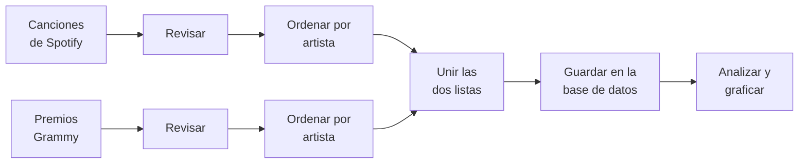

Cada caja es una tarea, y un programa llamado **Apache Airflow** se encarga de ejecutarlas **en orden y de forma automática**. Si una falla, las siguientes no arrancan, así nunca se guarda información a medias.

### Palabras que vas a ver en este documento

| Palabra | Qué significa, en simple |
|---|---|
| **ETL** | Las tres etapas del trabajo: **sacar** los datos (*Extract*), **arreglarlos** (*Transform*) y **guardarlos** (*Load*). |
| **Airflow** | El "director de orquesta": dice qué tarea va primero, cuál después, y avisa si algo falla. |
| **DAG** | Un proceso dentro de Airflow: la lista de tareas y su orden. En la pantalla se ve como cajas unidas con líneas. |
| **Base de datos (PostgreSQL)** | Un lugar ordenado para guardar tablas de información, como un Excel muy grande y muy seguro. |
| **Docker** | Una "caja" que trae Airflow ya instalado y listo, para no tener que configurarlo a mano. |
| **Pandera** | Una librería de Python que permite escribir reglas para los datos (tipos, valores vacíos, rangos) y comprobarlas de forma automática. |
| **Outer join** | Una forma de unir dos listas que conserva a todos los que aparecen en cualquiera de las dos, aunque no estén en la otra. |
| **Parquet** | Un formato de archivo compacto que usan las tareas para pasarse datos entre sí. |
| **Notebook** | Un documento que mezcla explicaciones, cálculos y gráficas en un solo lugar. |

---

## 3 · Cómo se construyó, paso a paso

### Paso 1 · Preparar la base de datos

Se creó la base de datos `workshop2_etl` en PostgreSQL y dentro de ella la tabla `grammy_awards`, donde se cargaron los 4.810 premios. El código para crear las tablas está en `docs/scripts_sql.sql`.

<p align="center">
  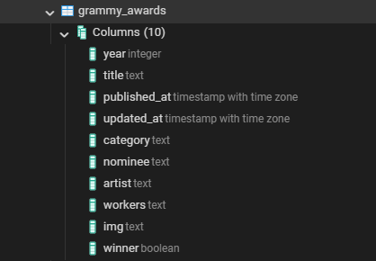
</p>

<p align="center"><em>La tabla de premios con sus 10 columnas: año, categoría, artista, si ganó, etc.</em></p>

> **Nota al cargar el CSV con pgAdmin:** en la ventana *Import/Export Data* hay que activar la opción **Header**. Si no, PostgreSQL intenta cargar la fila de títulos como si fuera un dato y falla con un error de tipo `integer` en la columna `year`.

### Paso 2 · Encender Airflow

Airflow se instaló dentro de Docker con el archivo `docker-compose.yaml`, que es el oficial de Airflow con dos ajustes:

- Se agregaron las carpetas `data/` y `output/` como volúmenes, para que Airflow pueda leer los CSV originales y escribir los resultados.
- Se desactivaron los DAG de ejemplo (`AIRFLOW__CORE__LOAD_EXAMPLES: 'false'`), para que en la pantalla solo aparezcan los del proyecto.

El archivo `.env` define el identificador de usuario de Airflow (`AIRFLOW_UID`) y la librería extra que se instala al arrancar (`pandera`). No contiene contraseñas.

La primera vez se inicializa con `docker compose up airflow-init` y luego se enciende con `docker compose up -d`. La interfaz queda en http://localhost:8080.

Después se le dio la "dirección" de la base de datos creando una conexión llamada `postgres_workshop`:

| Dato | Valor |
|---|---|
| Nombre de la conexión | `postgres_workshop` |
| Tipo | Postgres |
| Servidor | `host.docker.internal` |
| Base de datos | `workshop2_etl` |
| Usuario | `postgres` |
| Contraseña | La de tu PostgreSQL. Se escribe solo en Airflow, nunca en el código |
| Puerto | `5432` |

> **¿Por qué `host.docker.internal` y no `localhost`?** Airflow vive dentro de la "caja" de Docker. Para salir de la caja y llegar a la base de datos del computador necesita esa dirección especial.

### Paso 3 · Probar que todo se comunica

Antes de mover datos, se creó un proceso muy pequeño, `test_conexion_postgres`, con una sola tarea: **contar los premios** de la base de datos. Si cuenta bien, la conexión funciona.

<p align="center">
  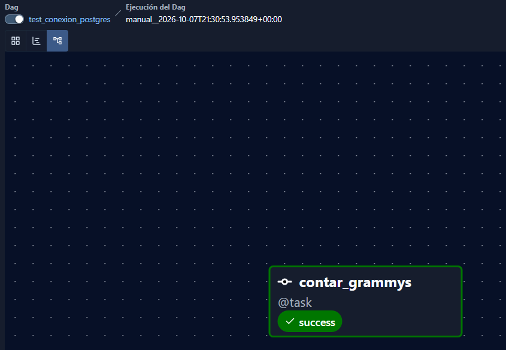
</p>

<p align="center"><em>La tarea <code>contar_grammys</code> terminó en verde: Airflow sí llega a la base de datos.</em></p>

### Paso 4 · Revisar los datos antes de usarlos

El segundo proceso, `validar_datasets`, revisa **las dos fuentes al mismo tiempo** con **Pandera**. Antes de aplicar las reglas, cada tarea imprime en su registro un perfil de calidad: filas, columnas, tipos, valores vacíos, valores distintos y mínimos y máximos.

<p align="center">
  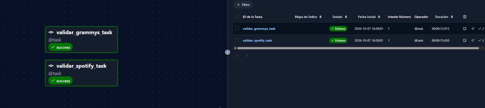
</p>

<p align="center"><em>Las dos revisiones terminaron con éxito, cada una en unos 13 segundos.</em></p>

**Reglas que se comprueban**

| Fuente | Reglas |
|---|---|
| **Spotify** | `track_id` y `track_genre`: texto, sin vacíos. `artists`, `album_name` y `track_name`: texto, se tolera hasta 1 % de vacíos. `popularity`: entero entre 0 y 100. `duration_ms`: entero mayor que 0. `explicit`: verdadero o falso. `danceability`, `energy`, `speechiness`, `acousticness`, `instrumentalness`, `liveness` y `valence`: decimal entre 0 y 1. `key`: entero entre -1 y 11. `mode`: 0 o 1. `loudness`: entre -60 y 10 dB. `tempo`: mayor o igual a 0. `time_signature`: entero entre 0 y 7. |
| **Grammys** | `year`: entero entre 1958 y 2019. `title` y `category`: texto, sin vacíos. `winner`: verdadero o falso, sin vacíos. `published_at`, `updated_at`, `nominee`, `artist`, `workers` e `img`: pueden venir vacíos. |

**Qué pasa cuando una regla falla.** La validación recoge **todos** los errores a la vez y los resume en una tabla con la columna, la regla incumplida y el número de casos. La tarea queda en rojo, **no se reintenta** y las tareas siguientes no se ejecutan. Si todo pasa, el registro muestra `VALIDACION APROBADA` con el número de filas.

**Qué se encontró.**

- En Spotify, **1 canción tenía duración de 0 milisegundos**, algo imposible. Se aparta en `output/rechazados_spotify.csv` y quedan **113.999 canciones válidas**, que sí pasan todas las reglas.
- La tabla de Grammys pasó todas las reglas sin necesidad de limpieza.
- El perfil de calidad también mostró que una canción no tiene artista, álbum ni nombre, y que una misma canción aparece varias veces (una por género), lo que se tiene en cuenta en la transformación.

### Paso 5 · El proceso principal

Con la conexión probada y los datos revisados, se construyó el proceso completo: **`etl_spotify_grammys`**, con 9 tareas.

<p align="center">
  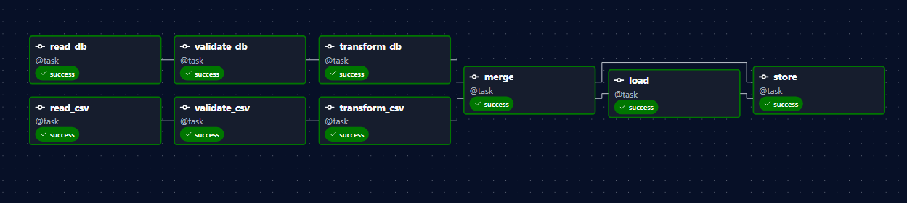
</p>

Se lee de izquierda a derecha. Las dos filas de arriba trabajan **en paralelo**, una por cada fuente, y se juntan en `merge`:

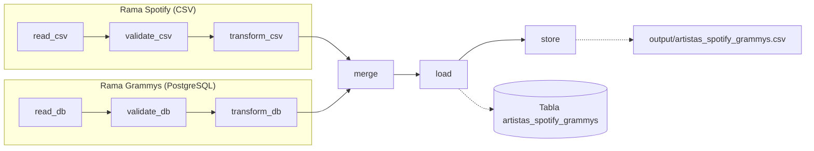

| # | Tarea | Qué hace, en simple |
|:-:|---|---|
| 1 | `read_db` | Trae los 4.810 premios desde la base de datos. |
| 1 | `read_csv` | Abre el archivo con las 114.000 canciones de Spotify. |
| 2 | `validate_db` | Revisa los premios **antes** de tocarlos. |
| 2 | `validate_csv` | Revisa las canciones. Las que no pasan la revisión se apartan en `output/rechazados_spotify.csv` para poder consultarlas. |
| 3 | `transform_db` | Quita los premios que no tienen un artista (por ejemplo, premios técnicos o a una obra), unifica la forma de escribir los nombres y agrupa: **un renglón por artista**, con su número de premios y sus años. |
| 3 | `transform_csv` | Agrupa las canciones: **un renglón por artista**, con el promedio de popularidad, energía, duración, etc. |
| 4 | `merge` | **Une las dos listas** usando el nombre del artista. No se descarta a nadie: si un artista solo está en una de las dos, igual queda en la lista. |
| 5 | `load` y `store` | Guardan el resultado en dos lugares: la tabla `artistas_spotify_grammys` de la base de datos y el archivo `output/artistas_spotify_grammys.csv`. |

> **¿Por qué revisar antes de transformar?** Es como revisar los ingredientes antes de cocinar: si algo viene dañado, es mejor detectarlo al principio que descubrirlo en el plato final.

Mientras corre, cada tarea deja una copia de su trabajo en `data/staging/` (archivos `.parquet`). Así, si algo falla, se puede ver exactamente en qué punto quedó. Entre tareas solo viajan rutas y conteos, no los datos completos.

**Los tres procesos terminaron en verde:**

<p align="center">
  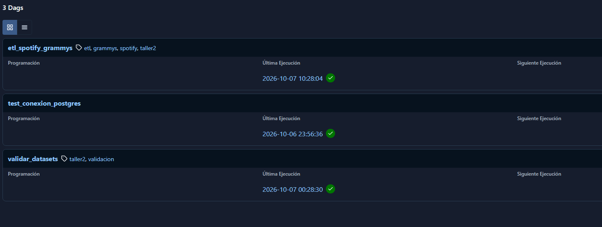
</p>

#### Cómo se llevan las dos fuentes al mismo nivel

Spotify tiene una fila por **canción** y Grammys una fila por **premio**. No existe una columna que diga qué canción corresponde a qué premio; lo único que comparten es el **artista**. Por eso ambas fuentes se transforman a **una fila por artista** antes de unirse.

**Spotify**

- Se elimina la columna `Unnamed: 0`, que es solo un índice.
- El campo `artists` puede traer varios artistas separados por `;`. Se separa para tener una fila por canción y artista.
- Una misma canción aparece una vez por cada género. Se deja una sola antes de promediar, para que ninguna canción pese más que otra.
- Por artista se calculan: número de canciones, popularidad, duración, proporción de canciones explícitas, bailabilidad, energía, valencia, acústica y tempo promedio, y el género más frecuente.

**Grammys**

- Se conservan las filas de premios ganados (en este archivo son todas) y se descartan las que no tienen artista.
- Por artista se calculan: número de premios, primer y último año, y categorías distintas.

**Nombres**

- Los nombres de ambas fuentes se escriben de forma uniforme (minúsculas, sin tildes, sin espacios repetidos y sin paréntesis) y eso forma la llave `artista_key`. Por ejemplo, `(Depeche Mode)` en Grammys se une con `Depeche Mode` en Spotify.
- Se excluye `Various Artists`, porque es una etiqueta para recopilaciones y no un artista.

#### Por qué se usó un outer join

El archivo de Spotify es una muestra por géneros, no el catálogo completo, así que muchos artistas premiados no están en él. Según el tipo de unión, el resultado cambia:

| Tipo de unión | Qué conserva | Artistas |
|---|---|---:|
| Inner join | Solo los que están en las dos fuentes | 533 |
| Left join desde Spotify | Todos los de Spotify; se pierden los premiados que no están en Spotify | 29.794 |
| **Outer join (el usado)** | **Todos los de las dos fuentes** | **30.907** |

Un ejemplo: U2 es el artista con más premios (18) y no aparece en el archivo de Spotify. Con un inner join o un left join habría desaparecido del resultado.

Con el outer join no se pierde información, y dos columnas indican la procedencia de cada artista: `en_spotify` y `tiene_grammy`. Cada análisis filtra según lo que necesita: la comparación de popularidad y sonido usa los artistas de ambas fuentes, y los conteos de premios usan todos los artistas de Grammys.

#### Valores vacíos y carga

- Cuando un dato no existe, se guarda como **NULL** en la base de datos, para que los promedios y las gráficas lo ignoren solos. En el archivo CSV exportado se escribe como `sin dato`, para que sea legible.
- Los conteos sí se guardan como 0: un artista sin premios tiene 0 premios, y uno sin canciones tiene 0 canciones.
- La carga es **repetible**: borra el contenido de la tabla y lo vuelve a escribir en una sola transacción, y comprueba que el número de filas coincida. Correr el proceso varias veces deja siempre el mismo resultado, sin duplicados.

### Paso 6 · El resultado: una sola lista de artistas

La tabla final, `artistas_spotify_grammys`, tiene **30.907 artistas** y 18 columnas.

<p align="center">
  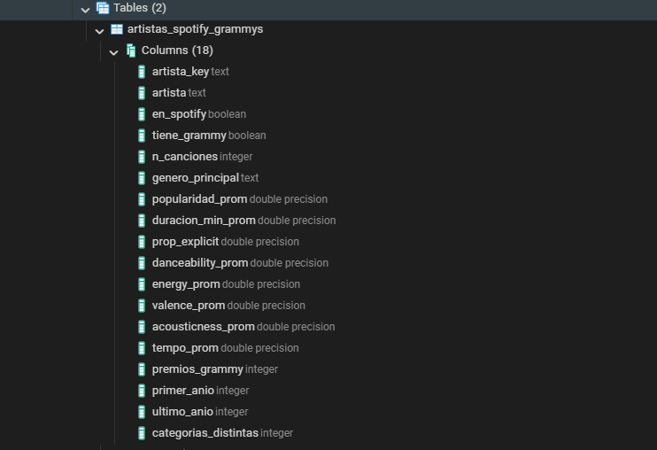
</p>

<details>
<summary><strong>Ver qué significa cada columna</strong></summary>

| Columna | Qué guarda |
|---|---|
| `artista_key` | El nombre escrito de forma uniforme (minúsculas, sin tildes), usado para unir las listas |
| `artista` | El nombre del artista tal como se muestra |
| `en_spotify` | ¿Aparece en Spotify? (sí / no) |
| `tiene_grammy` | ¿Ha ganado un Grammy? (sí / no) |
| `n_canciones` | Cuántas canciones suyas hay en Spotify |
| `genero_principal` | El género que más se repite en sus canciones |
| `popularidad_prom` | Su popularidad promedio en Spotify (de 0 a 100) |
| `duracion_min_prom` | Cuánto duran sus canciones en promedio (minutos) |
| `prop_explicit` | Qué parte de sus canciones tiene contenido explícito |
| `danceability_prom` | Qué tan bailables son (0 a 1) |
| `energy_prom` | Qué tan enérgicas son (0 a 1) |
| `valence_prom` | Qué tan alegres o positivas suenan (0 a 1) |
| `acousticness_prom` | Qué tan acústicas son (0 a 1) |
| `tempo_prom` | Velocidad promedio (pulsos por minuto) |
| `premios_grammy` | Cuántos Grammys tiene |
| `primer_anio` / `ultimo_anio` | Año de su primer y de su último Grammy |
| `categorias_distintas` | En cuántas categorías diferentes ha ganado |

</details>

<details>
<summary><strong>Ver el código SQL de la tabla</strong></summary>

```sql
CREATE TABLE IF NOT EXISTS artistas_spotify_grammys (
    artista_key          TEXT PRIMARY KEY,
    artista              TEXT NOT NULL,
    en_spotify           BOOLEAN NOT NULL,
    tiene_grammy         BOOLEAN NOT NULL,
    n_canciones          INTEGER NOT NULL,
    genero_principal     TEXT,
    popularidad_prom     DOUBLE PRECISION,
    duracion_min_prom    DOUBLE PRECISION,
    prop_explicit        DOUBLE PRECISION,
    danceability_prom    DOUBLE PRECISION,
    energy_prom          DOUBLE PRECISION,
    valence_prom         DOUBLE PRECISION,
    acousticness_prom    DOUBLE PRECISION,
    tempo_prom           DOUBLE PRECISION,
    premios_grammy       INTEGER NOT NULL,
    primer_anio          INTEGER,
    ultimo_anio          INTEGER,
    categorias_distintas INTEGER NOT NULL
);
```

El proceso `etl_spotify_grammys` crea esta tabla solo si no existe, por lo que ejecutar el script antes no es obligatorio. El archivo completo, con comentarios por columna y consultas de verificación, está en `docs/scripts_sql.sql`.

</details>

**Cómo comprobar que la carga quedó bien.** En pgAdmin, estas consultas deben dar 30.907 artistas en total y la siguiente composición:

```sql
SELECT COUNT(*) FROM artistas_spotify_grammys;

SELECT en_spotify, tiene_grammy, COUNT(*) AS artistas
FROM artistas_spotify_grammys
GROUP BY en_spotify, tiene_grammy
ORDER BY en_spotify, tiene_grammy;
```

| `en_spotify` | `tiene_grammy` | Artistas |
|---|---|---:|
| falso | verdadero | 1.113 |
| verdadero | falso | 29.261 |
| verdadero | verdadero | 533 |

### Paso 7 · Analizar y graficar

Por último, el notebook `notebooks/eda_spotify_grammys.ipynb` lee la base de datos y produce **12 gráficas organizadas en 5 preguntas**:

| Pregunta | Gráficas |
|---|---|
| **1. ¿Qué tan completa quedó la información?** | Embudo de datos · Composición de la unión |
| **2. ¿Cómo se reparten los Grammys?** | Premios por década · Top 10 artistas · Cuánto se concentran |
| **3. ¿Cómo es el catálogo de Spotify?** | Popularidad y número de canciones |
| **4. ¿Se diferencian los artistas con Grammy?** | Popularidad · Sonido · Época del primer premio · Género |
| **5. ¿Cómo se relacionan las características del sonido?** | Mapa de relaciones · Energía vs. acústica |

Todas las gráficas se guardan solas en `output/figuras/`, y un resumen de cifras en `output/hallazgos_eda.csv`.

El notebook trabaja a partir de la tabla integrada `artistas_spotify_grammys` y, para la gráfica de premios por década, de la tabla `grammy_awards`. Ambas se leen desde PostgreSQL. La única cifra que no sale de la base de datos es el total de 114.000 canciones del embudo, que se cuenta del archivo original porque la base no guarda ese dato.

---

## 4 · Qué descubrimos

### 1. No toda la información se puede usar, y eso es normal

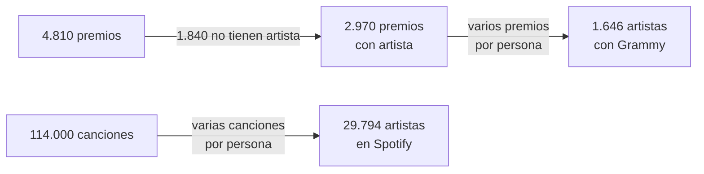

- **4 de cada 10 premios no tienen un artista**: suelen ser premios a una obra o a trabajos técnicos. No es un error, es como vienen los datos.
- Al agrupar por artista no se pierde información, solo se **resume**. Lo que sí se descarta son las 1.840 filas sin artista y las de `Various Artists`, que no es un artista.

<p align="center">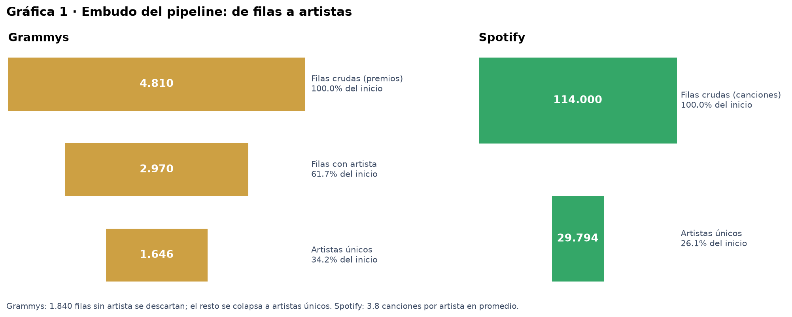</p>

### 2. Solo 1 de cada 3 artistas con Grammy aparece en Spotify

| Grupo | Artistas |
|---|---:|
| Solo en Spotify | 29.261 |
| En las dos fuentes | **533** |
| Solo en los Grammys | 1.113 |
| **Total** | **30.907** |

Los **533** artistas están en las dos listas, y esa es la cobertura de los Grammys en Spotify: **32,4 %**. Para comparar popularidad y sonido se usan los artistas con **al menos 3 canciones**, para que sus promedios sean estables: **372 con Grammy** frente a **9.744 sin Grammy**.

<p align="center">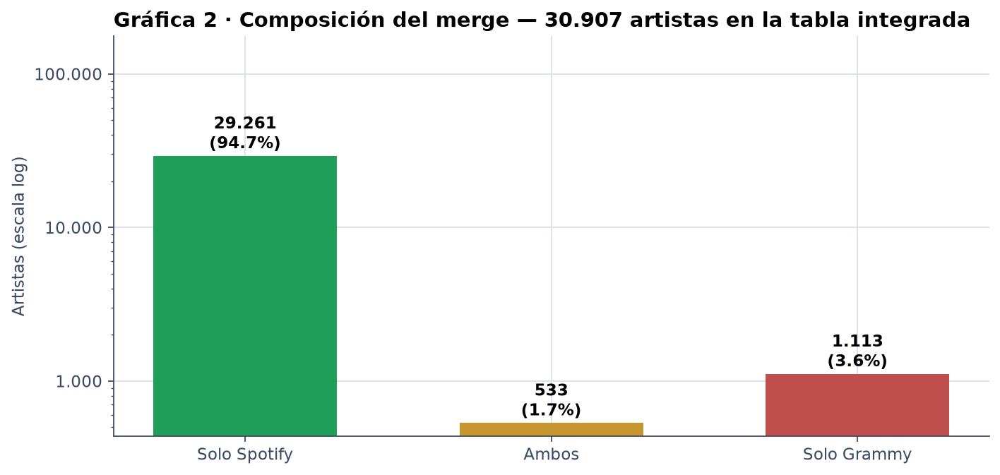</p>

### 3. Los Grammys están repartidos de forma moderada

- **7 de cada 10** artistas premiados tienen **un solo** Grammy.
- El **10 %** más premiado reúne cerca del **34 %** de todos los premios (coeficiente de Gini de 0,36).
- Hay artistas que destacan, pero el reconocimiento **no** está en manos de unos pocos.
- Los premios por año pasaron de unos 32 en la década de 1950 (el archivo solo tiene 1958 y 1959) a unos 121 en la década de 2010. La relación entre la cantidad de premios y la cantidad de categorías por década es moderada (r = 0,52), así que no alcanza para atribuir el aumento solo a la creación de nuevas categorías.

### 4. Tener un Grammy no te hace más escuchado

- La popularidad mediana de los artistas con Grammy es **33,3** y la de los demás es **34,3**: una diferencia de un punto, con un tamaño de efecto despreciable (r = +0,02).
- Se pensó que la época podía explicarlo (los premiados hace décadas se escucharían menos hoy). **No hay una tendencia clara**: el año del primer Grammy casi no se relaciona con la popularidad actual (ρ = +0,06, p = 0,28). Las medianas de los años 50 y 60 son más bajas que las de décadas posteriores, pero las décadas no suben de forma ordenada y cada una tiene un número limitado de artistas (el n aparece bajo cada caja de la gráfica).

<p align="center">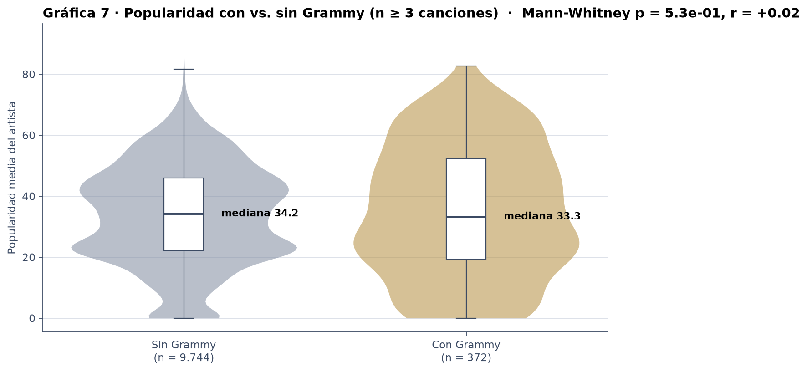</p>

<p align="center">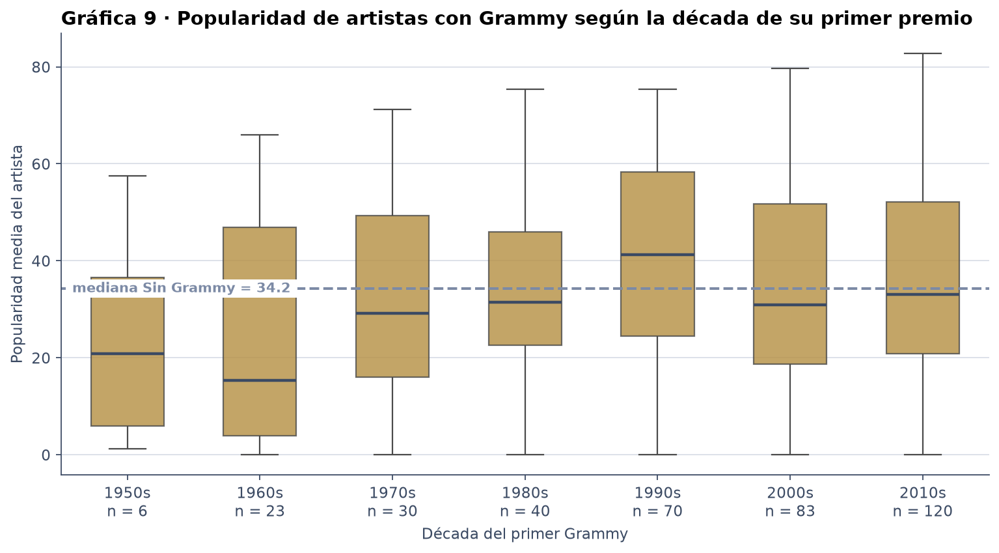</p>

### 5. Suenan casi igual

De 7 características del sonido, solo 2 muestran alguna diferencia, y es **pequeña**:

- Los artistas con Grammy suenan un poco **menos enérgicos** (d de Cohen = -0,26).
- Y un poco **más alegres o positivos** (d de Cohen = +0,24).

No existe un "sonido ganador". Es probable que las diferencias tengan más que ver con el **género** al que pertenecen: el género con mayor proporción de artistas con Grammy es el rock (23,0 % frente a 1,8 % en todo el catálogo).

<p align="center">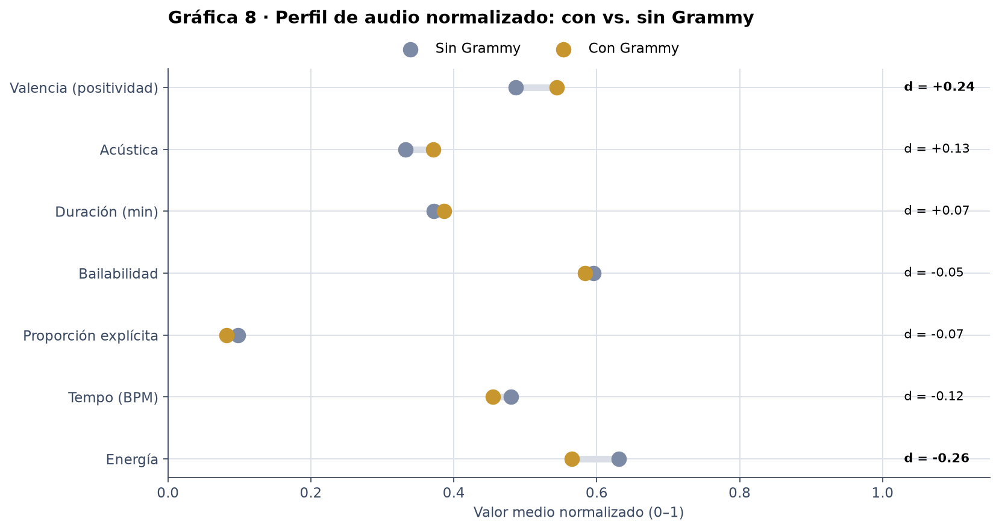</p>

### 6. A más energía, menos sonido acústico

La relación más fuerte de todo el proyecto: **los artistas más acústicos casi siempre tienen poca energía**, y al revés (correlación de -0,83). La gráfica 12 muestra esta relación por separado para artistas con y sin Grammy.

<p align="center">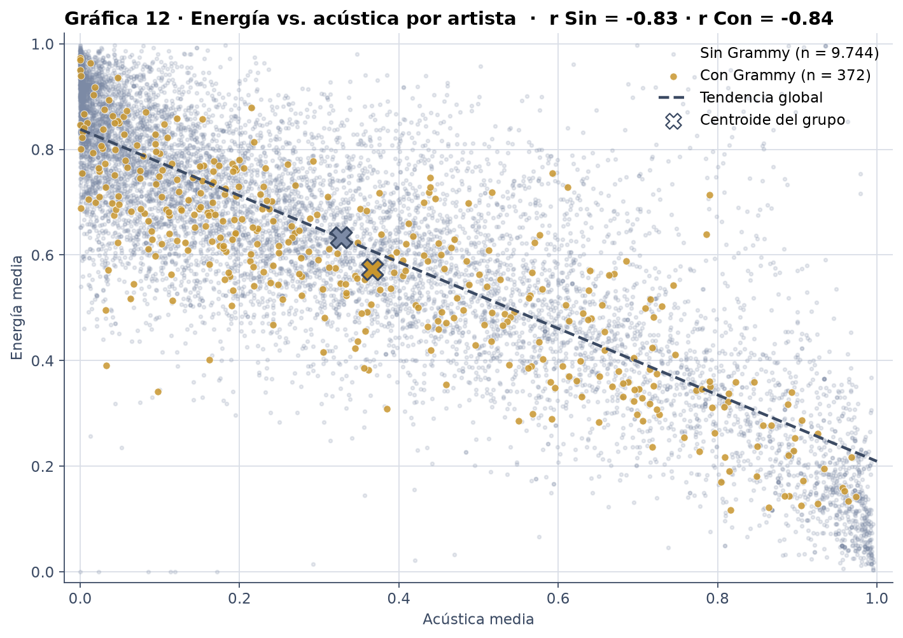</p>

> Las 12 gráficas completas, con su explicación, están en el notebook y en `output/figuras/`.

---

## 5 · Lo que hay que tener en cuenta

- **La unión se hace por el nombre exacto.** Si un artista aparece escrito distinto en cada fuente (por ejemplo, "The Beatles" y "Beatles") o si una colaboración viene en un solo campo, puede quedar como dos artistas diferentes. Solo 533 de los 1.646 artistas de Grammys se encontraron en Spotify.
- **El archivo de Spotify es una muestra.** Tiene 114 géneros y 114.000 canciones, no el catálogo completo. Que un artista no aparezca no significa que no esté en Spotify.
- **El archivo de Grammys solo trae ganadores.** La columna `winner` es verdadera en las 4.810 filas, así que no es posible comparar artistas nominados contra ganadores. Cada fila es un premio.
- **El 38 % de los premios no tiene artista** y por eso no se puede cruzar con Spotify. Además, se excluye `Various Artists` porque no es un artista.
- **La popularidad es una foto del momento.** Mide qué tanto se escucha hoy, no a lo largo de su carrera.
- **La comparación usa artistas con al menos 3 canciones.** Con menos canciones, el promedio de un artista es el valor de una sola canción y es poco confiable.
- **Las conclusiones muestran relaciones, no causas.** Ver que dos cosas van juntas no prueba que una cause la otra.

---

## 6 · Cómo correr el proyecto

### Lo que necesitas instalado

- Docker Desktop (con al menos 4 GB de memoria asignados)
- PostgreSQL (con pgAdmin, opcional)
- Python 3 y VS Code con la extensión de Jupyter

### Pasos

**1. Prepara la base de datos.** Crea la base `workshop2_etl` y ejecuta `docs/scripts_sql.sql` para crear las tablas. Después carga `data/the_grammy_awards.csv` en la tabla `grammy_awards`, **con la opción Header activada**.

**2. Revisa el archivo `.env`.** Debe tener estas dos líneas (no lleva contraseñas):

```text
AIRFLOW_UID=50000
_PIP_ADDITIONAL_REQUIREMENTS=pandera[pandas]
```

Si al ejecutar el proceso una tarea falla por no encontrar `pyarrow`, agrégalo a la segunda línea: `pandera[pandas] pyarrow`.

**3. Crea las carpetas de Airflow** si no existen: `logs`, `plugins` y `config`.

**4. Enciende Airflow.** Abre Docker Desktop, espera a que diga que el motor está activo y, desde la carpeta del proyecto, ejecuta:

```bash
docker compose up airflow-init
docker compose up -d
```

El primero se ejecuta solo la primera vez. Cuando termine de arrancar (uno o dos minutos), abre http://localhost:8080 con usuario `airflow` y contraseña `airflow`, que son los valores por defecto.

**5. Crea la conexión.** En Airflow, ve a *Admin → Connections* y crea `postgres_workshop` con los datos del [Paso 2](#paso-2--encender-airflow).

**6. Ejecuta los procesos en este orden**, pulsando el botón de ejecutar (*Trigger*) de cada uno:

| Orden | Proceso | Para qué |
|:-:|---|---|
| 1 | `test_conexion_postgres` | Confirmar que Airflow llega a la base de datos |
| 2 | `validar_datasets` | Revisar las dos fuentes |
| 3 | `etl_spotify_grammys` | Hacer todo el trabajo y guardar el resultado |

Al terminar, la tabla `artistas_spotify_grammys` debe tener 30.907 filas (ver las consultas de comprobación del [Paso 6](#paso-6--el-resultado-una-sola-lista-de-artistas)).

**7. Corre el notebook.** Instala las librerías:

```bash
pip install pandas sqlalchemy psycopg2-binary matplotlib seaborn scipy ipykernel
```

Abre `notebooks/eda_spotify_grammys.ipynb` en VS Code y elige **Run All**. El notebook te pedirá la contraseña de PostgreSQL en un cuadro oculto.

> **Seguridad:** el notebook nunca guarda la contraseña. **No la escribas** en el código ni en el archivo `.env`, porque si subes el proyecto a GitHub quedaría visible para cualquiera.

> **Nota:** el notebook se conecta a `localhost` (no a `host.docker.internal`), porque corre directamente en tu computador, fuera de Docker.

### Problemas frecuentes

| Qué ves | Causa probable | Qué hacer |
|---|---|---|
| `failed to connect to the docker API` al ejecutar `docker compose` | Docker Desktop está apagado | Abrirlo y esperar a que el motor esté activo |
| `localhost:8080` rechaza la conexión | Airflow todavía está arrancando o no se encendió | Esperar uno o dos minutos y revisar con `docker compose ps -a` |
| Un proceso nuevo no aparece en la lista | Airflow tarda cerca de un minuto en leer la carpeta `dags/` | Esperar y recargar la página |
| Error de sintaxis de entrada para tipo `integer` en la columna `year` al cargar el CSV | La opción Header estaba desactivada | Repetir la importación con Header activado |
| Una tarea de validación sale en rojo | Los datos no cumplen alguna regla | Abrir el registro de la tarea: muestra la columna, la regla y el número de casos |

---

## 7 · Qué hay en cada carpeta

```text
taller2_etl_airflow/
│
├── README.md                 ← Este documento
├── .gitignore                ← Archivos que no se suben a GitHub
├── docker-compose.yaml       ← Instrucciones para encender Airflow con Docker
├── .env                      ← Ajustes de Docker (no poner contraseñas aquí)
│
├── dags/                     ← Los procesos de Airflow
│   ├── test_conexion.py          · Prueba la conexión
│   ├── validar_datasets.py       · Revisa las dos fuentes
│   ├── etl_spotify_grammys.py    · El proceso principal (9 tareas)
│   ├── validaciones.py           · Las reglas de revisión (Pandera)
│   └── transformaciones.py       · Las reglas de limpieza y agrupación
│
├── data/
│   ├── dataset_spotify.csv       · Canciones de Spotify (fuente original)
│   ├── the_grammy_awards.csv     · Premios Grammy (fuente original)
│   └── staging/                  · Copias de cada paso intermedio
│
├── notebooks/
│   └── eda_spotify_grammys.ipynb · Análisis con las 12 gráficas
│
├── output/
│   ├── artistas_spotify_grammys.csv · Resultado final
│   ├── rechazados_spotify.csv       · Canciones que no pasaron la revisión
│   ├── hallazgos_eda.csv            · Resumen de cifras del análisis
│   └── figuras/                     · Las 12 gráficas en imagen
│
├── docs/
│   ├── scripts_sql.sql           · Código para crear las tablas de premios y del resultado
│   ├── img/                      · Capturas usadas en este README
│   └── Lo_que_hay_que_hacer/     · Enunciado del taller
│
├── logs/                     ← Registro automático de cada ejecución de Airflow
├── plugins/                  ← Carpeta que Airflow necesita (vacía)
└── config/                   ← Configuración de Airflow
```

**Qué no se sube a GitHub** (lo define `.gitignore`): `logs/`, `data/staging/` y los archivos temporales de Python y Jupyter. La carpeta `output/figuras/` sí se sube, porque este documento muestra esas imágenes.

---

<p align="center">
  Taller 2 · ETL con Apache Airflow
</p>
